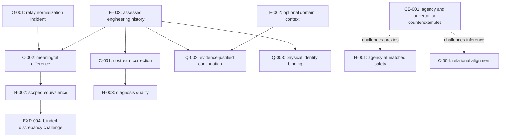

# Program — Karma / Adage ecosystem

## Objective

Use the existing ecosystem as both engineering platform and experimental apparatus for observable, governable autonomous systems.

## Latest director-cycle assessment

[RDC-001](cycles/RDC-001.md) adds an explicit belief/freshness assessment, decision map, six-factor qualitative ranking, skeptic/verifier passes, and a proposed oracle-feasibility investigation (Q-004). E-004 measures unchanged local pinned source bytes; it does not refresh historical runtime/live evidence. EXP-004 remains proposed and gated. [Current-state updates](../../current-state/proposals/RDC-001.json) remain review proposals; no maturity, readiness, or execution authority changed.

## First live research program — assessment dated 2026-10-10

The current Karma/Adage IoT digital-twin effort is Faraday's first live research program. Here, **live program** means research anchored in an ongoing engineering effort with reported and locally recorded real operations; it does not mean that the end-to-end IoT prototype is deployed or verified.

Investigate whether explicit intent, authenticated identity, artifact provenance, discrepancy-sensitive verification, and reviewed correction produce decisions that are both observable and governable. Determine where this architecture improves on standard validation, supply-chain integrity, least-privilege IAM, and human review, and where it merely renames them.

### Current claims and maturity

| Record / claim | Maturity | Current assessment |
| --- | --- | --- |
| C-001: trace correction to the earliest decision needing revision | FORMALIZED | History is suggestive, not a comparative test; unchanged. H-003 separates a measurable diagnosis claim. |
| C-002: representation differences need not matter to a decision | FORMALIZED | O-001 and E-003 add bounded case support; no general equivalence established. H-002 states a falsifiable verifier claim. |
| C-003: care differs from control through agency preservation | SPECULATIVE | IoT history provides no matched-safety agency evidence; unchanged. CE-001 challenges entropy and reachable-state proxies. |
| C-004: alignment is relational | SPECULATIVE | Observable boundaries are compatible with this view, but also with ordinary security engineering; unchanged. |
| H-001: care preserves more agency at matched safety | TESTABLE | Neither strengthened nor weakened by identity, artifact, or IAM results; policy labels and agency measures need further specification. |
| H-002: scoped equivalence reduces false discrepancy alarms without hiding defined drift | TESTABLE | New, untested beyond a motivating incident and inspected tests; proposed EXP-004 is a held-out test. |
| H-003: structured backward tracing improves earliest-assumption diagnosis | TESTABLE | New, untested; retrospective stories cannot establish improvement. |
| Authenticated ingress and device-OFFLINE rejection in current Lambda source | Bounded local finding, not a promoted general hypothesis | 17 local synthetic tests passed; live principal provenance remains unresolved. |
| Exact artifact publication and recovery | Historical evidence with mixed provenance | Publication verification is human-reported in an inspected binding spec; recovery has a local private receipt. Neither is independently re-executed here. |

### Evidence and interpretation

Read [E-003](../../evidence/E-003-live-program-history.md) for the assessment of all ten historical observations, justified/non-justified conclusions, competing interpretations, and proposed claim revisions. It separates source inspection, reproduced local tests, human reports, and retained execution receipts. [The source manifest](../../evidence/live-program-source-manifest.json) pins inspected working-tree bytes; private plans/state/receipts remain downstream and are not copied here.



Arrows mean motivates, bears on, or explicitly challenges; they do not mean proof or causation. E-001's toy checklist result supports the simpler-baseline challenge to the architecture, not ecosystem efficacy. E-002 remains true for the inspected prototype domain function; E-003 adds the separate Lambda implementation and current IaC contract rather than overwriting that history.

### Highest-information-value next experiment

Recommend [EXP-004](../../experiments/EXP-004-blinded-discrepancy-challenge.md): a blinded offline comparison of strict equality, broad normalization, and scoped equivalence, with frozen labels and held-out meaningful drift. This tests a general verification principle at low operational cost rather than finishing deployment.

This is an ordinal, subjective choice. No calibrated hypothesis probabilities exist, so no numerical expected information gain is claimed.

| Candidate | What it distinguishes | Why this priority |
| --- | --- | --- |
| Blinded discrepancy challenge | Useful scoped equivalence versus brittle strict equality versus unsafe permissiveness | First: three concrete alternatives, one observed motivating failure, cheap held-out negative cases |
| Physical identity end-to-end | Real provenance binding versus payload assertion or credential-possession-only assurance | Important second step; needs real device/IoT evidence and separately reviewed access, with more confounded failure modes |
| Earliest-assumption diagnosis | Backward tracing versus ordinary root-cause analysis/local patching | Valuable; needs multiple independent incidents, a defensible root-cause oracle, and controls for hindsight |
| Agency at matched safety | Agency preservation versus uncertainty reduction | Conceptually important; metric and policy definitions are not yet sufficiently settled to make this the first program experiment |

### Unresolved questions and strongest counterarguments

- Q-002 remains OPEN: which verified evidence licenses which action under which rule?
- Q-003 remains OPEN: can a real authenticated principal be bound to this physical device without trusting payload fields, including forged principal/topic fields and changed certificate mappings?
- Can H-002 generalize beyond the one resource/provider/version exception without a growing allowlist that eventually conceals drift?
- What makes a difference decision-relevant? Equivalence must name the decision and observer; byte equality and operational equivalence answer different questions.
- Are C-001's benefits anything beyond ordinary root-cause analysis, and can the earliest incorrect assumption be determined when there are multiple causes?
- Does preserving agency improve an independently defined outcome at matched safety/resources, rather than simply increasing a chosen proxy?
- An authenticated certificate proves control of a credential in a protocol context; it does not by itself prove uncompromised physical origin or truthful IMU values.
- Exact bytes can still be malicious or inappropriate. Provenance and artifact identity do not establish intent, correctness, authorization, or runtime behavior.
- A gate stopping once and a reviewed IAM change are evidence of particular procedures, not proof that bypass is impossible or privileges remain minimal over time.
- A strict verifier's initial failure can be a useful safe stop. Fewer failures alone are not improvement if material differences become invisible.
- Separation into named ecosystem layers can add interfaces, cost, and opportunities for lost context. Ordinary checklists, schemas, conditional writes, and human review remain viable explanations for every observed benefit.

### Conditional downstream involvement and authority boundary

If the experiment is approved, `aws-iac` would supply verifier fixtures and comparison behavior; `aws-config` would supply desired-state/schema cases; `aws-lambda` and `iot-digital-twin` could supply identity/state cases. Adage provides the proposed intent/constraint framing, Fabric the evidence-return framing, and Karma the proposed decision framing; no changes to their repositories are presently necessary. Each repository's own instructions and permissions would still govern any later work.

**STOP_FOR_HUMAN: No new cross-repository work package may be created, routed, or implemented before the human reviews EXP-004, its scope, oracle, and acceptance criteria.** Existing WP-001/WP-002 are historical proposals; WP-002 is not approval for this experiment or downstream edits. Human decision required: approve, revise, or reject EXP-004 and its bounded H-002 claim before any package creation. No cloud execution is included in that decision.

## Responsibilities

- **Faraday** — questions, hypotheses, experiments, program direction, knowledge revision.
- **Adage** — infrastructure/control architecture.
- **aws-config** — desired-state declarations.
- **aws-iac** — controlled implementation and evidence-oriented execution.
- **adage-fabric** — observation/event substrate.
- **Karma** — evidence interpretation, governance, provenance, allowed action.
- **iot-digital-twin** — physical experimental apparatus.

## Current program thread

The IoT digital twin should demonstrate a complete chain:

```text
human intent
→ explicit specification
→ immutable implementation artifact
→ authenticated physical identity
→ observable telemetry/action
→ evidence
→ discrepancy detection
→ upstream correction
→ human-reviewed continuation
```

## Current questions

1. Can authenticated device identity be proven end-to-end without trusting payload identity?
2. Can system verification distinguish semantic drift from representational normalization without becoming permissive?
3. Can evidence generated by real engineering failures improve upstream specifications systematically?
4. Which measurements are useful for agency preservation without turning them into proxy objectives?
